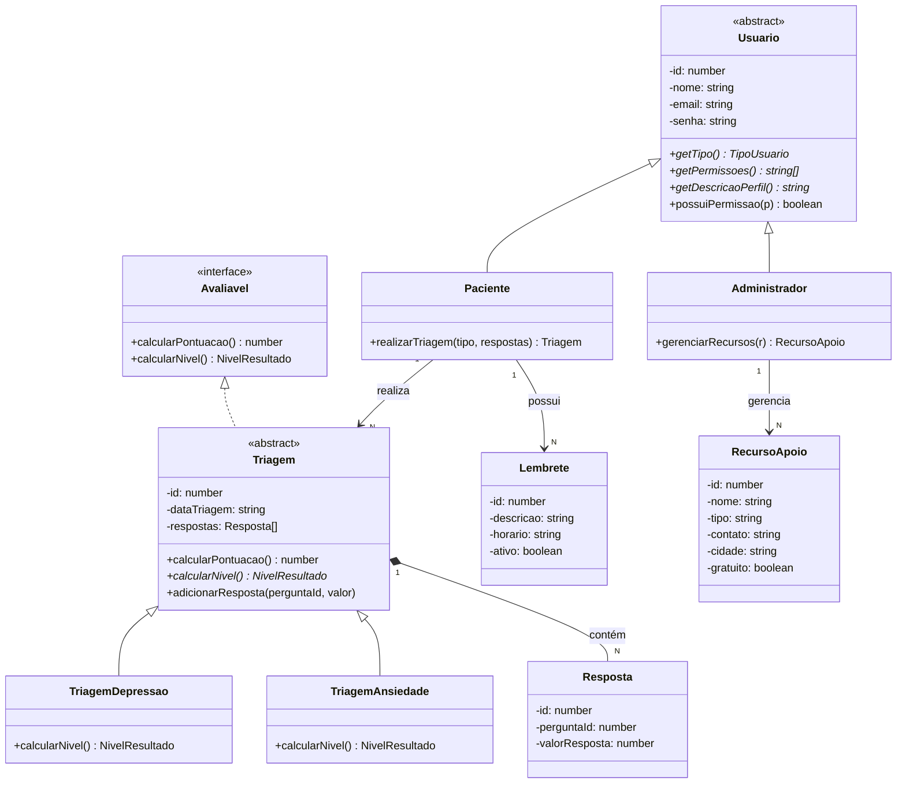

# Arquitetura do CuidaMente

## Visão geral

```
┌──────────────────────┐   HTTP/JSON    ┌────────────────────────────────────────────┐   SQL   ┌─────────┐
│  Front-end (React)   │ ─────────────▶ │  API REST (Node.js + Express + TypeScript) │ ──────▶ │ MySQL 8 │
│  src/frontend        │ ◀───────────── │  routes → controllers → services → repos   │ ◀────── │         │
└──────────────────────┘                └────────────────────────────────────────────┘         └─────────┘
```

A API é organizada em camadas:

| Camada | Pasta | Responsabilidade |
|---|---|---|
| Rotas | `routes/` | Liga cada URL ao método do controller e aplica autenticação/permissão. |
| Controllers | `controllers/` | Lê a requisição, chama o serviço/repositório e devolve JSON. |
| Services | `services/` | Regras de negócio (login, realizar e corrigir triagem, resumo do painel). |
| Models | `models/` | Classes de domínio: onde estão herança, interface, polimorfismo e composição. |
| Repositories | `repositories/` | CRUD no MySQL com consultas parametrizadas (protege contra SQL injection). |
| Middlewares | `middlewares/` | Valida o token JWT, checa permissões e converte erros em respostas HTTP. |

## Diagrama de classes (como implementado)



### Ajuste em relação ao diagrama da 1ª entrega

O diagrama da 1ª entrega já tinha `Usuario` abstrata, `Paciente`/`Administrador`, a interface `Avaliavel` e as duas triagens sobrescrevendo `calcularNivel()`. Na implementação foi incluída a classe abstrata **`Triagem`** entre a interface e as duas triagens. Ela concentra o que é comum (lista de respostas, cálculo da pontuação e validação) e evita código duplicado. As duas classes concretas continuam implementando `Avaliavel` (por herança) e continuam sobrescrevendo `calcularNivel()` com suas regras próprias, exatamente como planejado. Os nomes de atributos, métodos e tabelas foram mantidos.

Também foi adotado **TypeScript** no lugar de JavaScript puro. É a mesma pilha Node.js + React da justificativa técnica, mas com tipagem estática e a palavra-chave `override`, exigida pela rubrica da 2ª entrega ("código tipado" e "polimorfismo via override").

## Onde está cada pilar de POO

| Pilar | Arquivo | Como |
|---|---|---|
| Classe abstrata | `models/Usuario.ts` | `abstract class Usuario` com `getTipo()`, `getPermissoes()` e `getDescricaoPerfil()` abstratos; construtor `protected`. |
| Classe abstrata | `models/Triagem.ts` | `abstract class Triagem implements Avaliavel` com `calcularNivel()`, `getPerguntas()` e `getInstrumento()` abstratos. |
| Classe abstrata genérica | `repositories/RepositorioBase.ts` | Implementa buscar, listar e excluir para qualquer tabela; as subclasses definem tabela, chave e `mapearLinha()`. |
| Interface | `models/Avaliavel.ts`, `repositories/Repositorio.ts` | Contratos de avaliação e de CRUD. |
| Herança | `Paciente.ts`, `Administrador.ts`, `TriagemDepressao.ts`, `TriagemAnsiedade.ts`, todos os `*Repository.ts`, `ErroNaoEncontrado`/`ErroAcessoNegado` | `extends`. |
| Polimorfismo | `TriagemService.realizar()` | Trabalha com o tipo `Triagem`; em tempo de execução é chamado o `calcularNivel()` do PHQ-9 ou do GAD-7. |
| Polimorfismo | `UsuarioRepository.mapearLinha()` | Cria `Paciente` ou `Administrador` conforme `tipo_usuario`; o restante do sistema usa `Usuario`. |
| Composição 1:N | `Triagem.adicionarResposta()` | A triagem cria e guarda suas respostas; não há como criar uma `Resposta` solta no fluxo. No banco: `ON DELETE CASCADE` e gravação em transação única. |
| Encapsulamento | todos os models | Atributos `private`, validação nos setters (e-mail, nome, horário HH:MM, valor 0–3). |

O `tsconfig.json` do back-end usa `"noImplicitOverride": true`: o compilador recusa qualquer método sobrescrito sem a palavra `override`, o equivalente ao `@Override` do Java.

## Regras de pontuação (RF01)

Cada pergunta vale de 0 a 3 (Nenhuma vez · Vários dias · Mais da metade dos dias · Quase todos os dias), referente às últimas 2 semanas.

| Instrumento | Pontos | Bem | Atenção | Crise |
|---|---|---|---|---|
| PHQ-9 (`TriagemDepressao`) | 0–27 | 0–4 | 5–14 | ≥ 15 **ou** qualquer resposta acima de "Nenhuma vez" na pergunta 9 (pensamentos de autolesão) |
| GAD-7 (`TriagemAnsiedade`) | 0–21 | 0–4 | 5–14 | ≥ 15 |

Os cortes seguem as faixas de gravidade publicadas por Kroenke et al. (2001) e Spitzer et al. (2006): mínimo (0–4), leve/moderado (5–14) e moderadamente grave/grave (≥ 15). A regra da pergunta 9 existe porque, em triagem, qualquer sinal de ideação de autolesão deve levar ao encaminhamento, independentemente da soma.

## Modelo de dados

O script `database/schema.sql` segue o DER da 1ª entrega (nomes de tabelas e colunas idênticos):

| Tabela | Classe | Observações |
|---|---|---|
| `usuarios` | `Usuario` / `Paciente` / `Administrador` | Herança em tabela única; `tipo_usuario` = `PACIENTE` ou `ADMIN`; e-mail único; senha com hash bcrypt. |
| `triagens` | `TriagemDepressao` / `TriagemAnsiedade` | `tipo` = `DEPRESSAO` ou `ANSIEDADE`; `nivel_resultado` = `BEM`, `ATENCAO` ou `CRISE`. |
| `respostas` | `Resposta` | FK para `triagens` com `ON DELETE CASCADE` (composição). |
| `lembretes` | `Lembrete` | FK para `usuarios` com `ON DELETE CASCADE`. |
| `recursos` | `RecursoApoio` | Catálogo gerenciado pelo administrador; cidade `Nacional` vale para todo o país. |

A pontuação não é gravada em coluna própria: é recalculada a partir das respostas armazenadas, como previsto na 1ª entrega ("permitindo recalcular pontuações").

## Segurança e privacidade

- Senhas armazenadas apenas como hash bcrypt.
- Sessão por token JWT com expiração configurável.
- Cada paciente só acessa as próprias triagens e lembretes (checagem de dono em toda leitura, edição e exclusão).
- O administrador gerencia usuários e recursos, mas não visualiza triagens de pacientes.
- Todas as consultas SQL usam parâmetros (`?`), nunca concatenação de valores do usuário.
